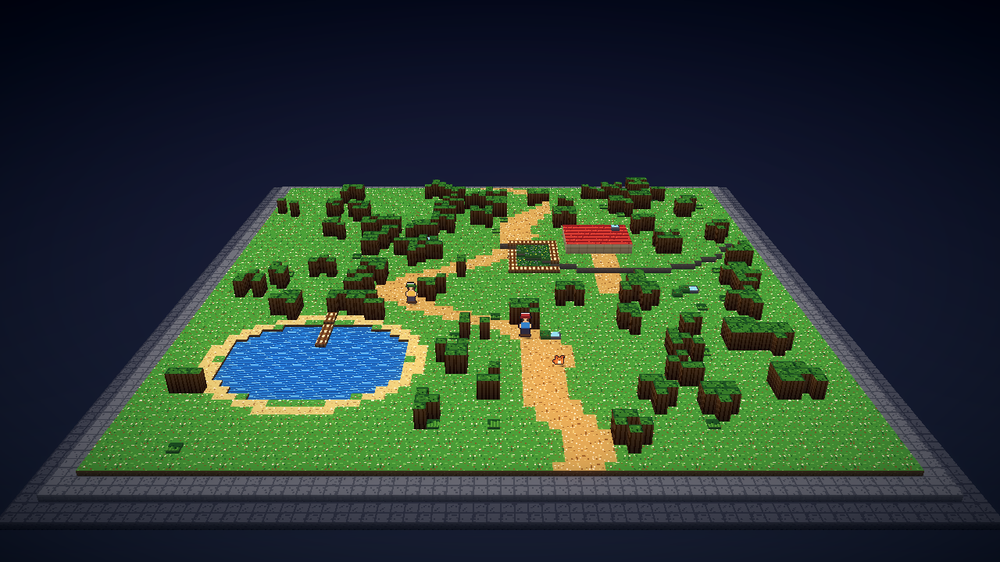
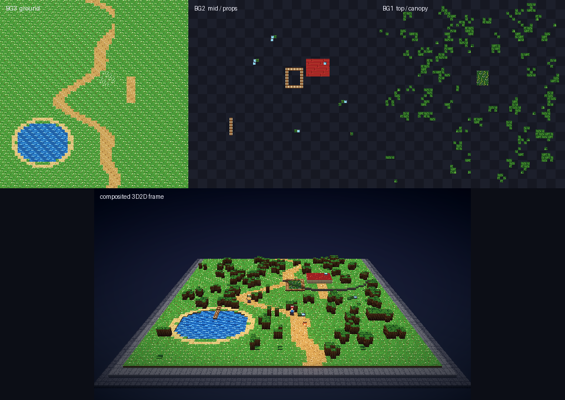

# gba-diorama

An experimental **3D2D** renderer lab for GBA-era games and romhacks.

The goal is not to upscale the final 240×160 frame. It is to take the GBA PPU's
already-separated background layers, reconstruct a small 3D diorama from them,
and composite 2D sprite art into that world — the "3D world, 2D characters"
look rather than a flat post-process.



The image above is generated entirely by this repo from a synthetic
GBA-format world: four 4bpp text-BG tilemaps, a 64×64 metatile map, extruded
terrain, billboard characters, contact shadows, and a CPU post stack.

The layers are decoded independently before meshing, which is the part that
makes a 3D2D composite possible:



## Why this exists

A GBA has four tiled background layers (BG0–BG3) plus an OBJ/sprite layer. An
emulator with a high-resolution renderer already has each of those layers as a
separate texture. That is the hard part of layer extraction, and it is already
solved by [mGBA](https://mgba.io/).

What is missing is a renderer that understands those layers as a *scene*:

- BG3 is usually the ground.
- BG2 is usually mid-height scenery.
- BG1 is usually foreground/canopy geometry that occludes sprites.
- BG0 is usually UI (textboxes, menus) and should stay flat.
- OBJ sprites are characters and props, which should become billboards.

Those roles are game- and scene-specific, so the core stays generic and the
roles live in **profiles** that can be edited and overridden per game, per
romhack, or per scene.

This is deliberately **not** a static recompilation. It has to work on arbitrary
ROMs and romhacks, so it only consumes PPU state: VRAM, OAM, palette, and the
BG/OBJ registers.

## Quick start

```bash
python3 -m venv .venv
. .venv/bin/activate
pip install numpy pillow pytest

python -m gba_diorama --out docs/images/demo.png
python -m pytest -q
```

Useful CLI options:

```bash
# Wider camera angle (degrees around the diorama)
python -m gba_diorama --yaw 18 --out /tmp/yaw18.png

# No bloom / tilt-shift / grading
python -m gba_diorama --no-post --out /tmp/raw.png

# Higher-resolution render
python -m gba_diorama --width 1920 --height 1080 --out /tmp/1080p.png

# Inspect a real mGBA dump (once the dump hook exists)
python -m gba_diorama.inspect path/to/dump --out /tmp/dump-layers
```

## How it works

```
mGBA PPU state (VRAM / OAM / palette / registers)
        │
        ▼
gba.py       decode BG0–BG3 to RGBA layer images + tilemap metadata
        │
        ▼
profiles     scene signature -> layer role, height, material, parallax
        │
        ▼
mesh.py      heightfields + side walls + base plinth + sprite billboards
        │
        ▼
raster.py    3D rasterizer (z-buffer, alpha test, blend, fog)
        │
        ▼
post.py      bloom, tilt-shift, vignette, grade
```

The same `mesh.py` path is used by the synthetic lab world and, later, by the
emulator. The synthetic world is not a mock-up of the decoder; it writes real
GBA tilemaps into a 0x18000-byte VRAM buffer and decodes them back through
`gba.py`. That keeps the offline lab honest.

### Current layer model

| Layer | Typical role | Geometry |
|---|---|---|
| BG3 | ground | heightfield, fully opaque |
| BG2 | mid scenery / props | heightfield, alpha-tested cutouts |
| BG1 | foreground / canopy | heightfield, alpha-tested cutouts |
| BG0 | UI / textbox | flat 2D overlay (not in the demo yet) |
| OBJ | characters / props | camera-facing billboards + shadows |

The synthetic world authors heights and materials directly. The next step is to
infer them (see `docs/EXPERIMENTS.md`).

### Coordinate system

World space is `(x, height, z)`, Y up. One world unit is one GBA BG pixel. The
synthetic map is 64×64 tiles (512×512 pixels). The camera looks down at roughly
25–30°, which is enough to read the diorama without exposing the missing
off-screen map data too badly.

## What works

- 4bpp and 8bpp text-BG decoding, per-tile palette banks, H/V flips, 32×32
  screen blocks, 256×256 / 512×256 / 256×512 / 512×512 maps.
- Palette decode and OAM entry decode primitives.
- A synthetic GBA-format overworld: terrain, plateau, pond, path, house,
  garden, fence, dock, trees, tall grass, flowers, rocks, bushes, and three
  characters.
- Heightfield meshing with greedy equal-height merging, per-cell side walls,
  material side textures, and a two-tier tabletop plinth.
- Camera-facing sprite billboards with leaning tops and radial contact shadows.
- Software 3D rasterizer: near-plane clipping, perspective-correct UVs,
  z-buffer, alpha test, alpha blending, fog.
- CPU post stack: bloom, tilt-shift DOF, vignette, grade.
- A loader/exporter for the mGBA dump format plus `python -m gba_diorama.inspect`
  to write layer PNGs from a dump.
- Deterministic CLI and 15 tests.

## What is not done yet

- No mGBA integration yet. The lab currently renders the synthetic world.
- No affine BG, bitmap BG, windows, mosaic, or GBA alpha/brightness effects.
- Sprites are procedural placeholders; OAM/OBJ tile decoding is only a
  primitive, not a full OBJ renderer.
- No scene detection or profile system yet.
- No temporal world atlas; the camera is intentionally mild so missing
  off-screen pixels are not obvious.
- The rasterizer is CPU-side and meant for iteration, not real-time emulator
  output.

## Repo map

```
gba_diorama/
  gba.py         GBA text-BG / palette / OAM decoding
  dump.py        load/export the mGBA dump format + DumpWorld adapter
  inspect.py     dump -> per-layer PNGs
  synthetic.py   synthetic GBA-format world (the test fixture)
  mesh.py        heightfields, side walls, plinth, sprite billboards
  raster.py      software 3D rasterizer
  post.py        bloom / tilt-shift / vignette / grade
  sprites.py     procedural pixel-art stand-ins
  pipeline.py    demo camera + render pipeline
  __main__.py    CLI
tests/           decoder, dump, mesh, raster, pipeline tests
docs/
  DESIGN.md      deeper architecture and rendering notes
  EXPERIMENTS.md experiments E1–E7, hypotheses and order
  MGBA-HANDOFF.md exact mGBA hooks and dump format
AGENTS.md        handoff notes for the next agent
```

## Roadmap

**M0 — offline lab (done)**
Synthetic GBA tilemaps → decoder → heightfield diorama → post stack.

**M1 — real layer dump**
The lab side is in place: `dump.py` reads the format, and `inspect.py` writes
per-layer PNGs. Next, add the opt-in dump hook to mGBA's GL renderer. Export
BG0–BG3, OBJ, window, backdrop, BG registers, palette, OAM, and a frame id.
Then render the same diorama from a real game frame.

**M2 — profiles and fallback**
Detect scene signature from `DISPCNT`/`BGxCNT` (BG mode, enabled mask,
priorities, affine mask, screen sizes). Map layers to roles via a data-only
profile. Keep the stock 2D composite for menus, battles, and affine/raster
scenes.

**M3 — world atlas and parallax depth**
Stitch BG layers into a persistent world atlas as the camera scrolls. Estimate
per-layer parallax from scroll deltas and convert that to depth. Add a per-sprite
atlas from OAM.

**M4 — mGBA GL pass**
Port the mesh + camera math to a `hd2d` pass inside mGBA's GL renderer, keeping
the existing `_finalizeLayers` as fallback. Start with a fixed camera and a
single scene profile.

**M5 — inference and presentation**
Tile classification (opaque ground vs. cutout object), collision-learned
heightmaps, temporal accumulation, shadows/AO, optional orbit camera, widescreen
and overscan.

## mGBA integration in one paragraph

Fork mGBA. `GBAVideoGLRendererFinishFrame()` at
`src/gba/renderers/gl.c:1573` already calls `_finalizeLayers()` at
`src/gba/renderers/gl.c:1696`, which binds `bg[0..3].tex` plus
`layers[OBJ_COLOR]`, `layers[OBJ_FLAGS]`, `layers[WINDOW]`, and
`layers[BACKDROP]`. Replace/augment that finalize pass with the 3D scene pass.
`GBAVideoGLRendererSetScale()` at `gl.c:2149` is the resize hook. The renderer
already has `bg[i].x/y`, `screenBase`, `charBase`, `size`, `priority`, and
`affine`; the `GBAVideoRenderer` vtable exposes `palette`, `vram`, and `oam`.
See `docs/MGBA-HANDOFF.md` for the exact fields and a proposed dump format.

## Design principles

1. **Game-agnostic core.** No Pokémon/Zelda constants in `gba.py`, `mesh.py`, or
   `raster.py`.
2. **Profiles are data, not code.** A romhack inherits its base game's profile
   and can override layer roles, heights, materials, and camera.
3. **Keep the 2D path.** Menus, battles, affine scenes, and unknown games must
   still render correctly through mGBA's stock composite.
4. **Infer, don't require.** Authored decomp data is a bonus, not a dependency.
5. **Pixel art stays pixel art.** Nearest filtering, integer-ish texel density,
   and restrained post FX; the 3D geometry can be smooth.

## Legal

This repo contains no ROMs, no game assets, and no Nintendo code. The synthetic
world and sprites are original placeholder art. Pokémon, Zelda, and GBA are
trademarks of Nintendo; this project is not affiliated with or endorsed by
Nintendo. Do not commit ROMs, saves, or extracted game assets.

The code is licensed under the Mozilla Public License 2.0 (MPL-2.0), which keeps
it compatible with a future mGBA fork.

## Handoff

If you are an agent continuing this work, read `AGENTS.md` first. The short
version:

- Run `python -m pytest -q` before and after changes.
- Keep `decode_text_bg()`'s API stable; it is the boundary between emulator and
  renderer.
- `Scene.triangles` are world-space and must not be mutated by the renderer.
- Add a test for every heuristic; the synthetic world is the regression fixture.
- Do not hardcode game-specific layer roles outside a profile.
